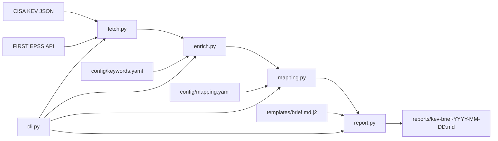

# kev-brief

A Python CLI that builds a CTI-style weekly brief from the [CISA Known Exploited Vulnerabilities catalog](https://www.cisa.gov/known-exploited-vulnerabilities-catalog) and [FIRST EPSS](https://www.first.org/epss/) scores.

## What it does

1. Downloads the CISA KEV JSON catalog.
2. Keeps entries whose `dateAdded` falls in the last N calendar days (`--days`, default 90).
3. Tags cloud and CI/CD products from `config/keywords.yaml` using whole-word matches. Non-matching rows stay in the data. `--only-cloud` is what drops them.
4. Fetches EPSS in batches of 50, with a timeout and retries. A CVE with no score stays blank and is shown as `n/a`. EPSS: n/a = not yet scored by FIRST (as of the report date).
5. Assigns one MITRE ATT&CK technique from `config/mapping.yaml` (CWE, then keyword, then T1190).
6. Writes `reports/kev-brief-YYYY-MM-DD.md`. The top 10 table is ordered by known ransomware use, then soonest CISA due date, then cloud/CI-CD relevance. EPSS is a column in that table, not the sort key. `--pdf` also runs pandoc when it is installed.

The command prints how many rows survived each stage (`Fetched`, `Date-filtered`, `Cloud/CI-CD-tagged`) so you can check the keyword list against live data.

## Architecture



## Data sources

| Source | URL | Used for |
|--------|-----|----------|
| CISA KEV | https://www.cisa.gov/sites/default/files/feeds/known_exploited_vulnerabilities.json | Exploited vulnerabilities, dates, required action, ransomware flag, CWEs |
| FIRST EPSS | https://api.first.org/data/v1/epss | Probability of exploitation activity in the next 30 days |

KEV fields used: `cveID`, `vendorProject`, `product`, `vulnerabilityName`, `dateAdded`, `shortDescription`, `requiredAction`, `dueDate`, `knownRansomwareCampaignUse`, `cwes`.

## Install and run

Requires Python 3.11+.

```bash
python3 -m venv .venv
source .venv/bin/activate
pip install -r requirements.txt

python -m kev_brief --days 90 --out reports/
python -m kev_brief --days 90 --only-cloud --out reports/ --pdf
pytest
```

| Flag | Default | Meaning |
|------|---------|---------|
| `--days` | 90 | Keep `dateAdded` within this many calendar days |
| `--only-cloud` | off | Drop rows that did not match `config/keywords.yaml` |
| `--out` | `reports/` | Directory for the Markdown file |
| `--pdf` | off | Also call pandoc. Needs pandoc and a PDF engine (xelatex, pdflatex, lualatex, tectonic, or typst). If either is missing, the Markdown file is still written |

If the KEV download fails, the process exits non-zero and prints the error.

After a live run, read the stage counts. If `Cloud/CI-CD-tagged` is only a handful of rows, raise `--days` or add product names to `config/keywords.yaml`. Then write 3–5 sentences in the `ANALYST SUMMARY` block before you treat the file as finished. The technique choices belong in `config/mapping.yaml`; see [mapping.md](mapping.md).

## Sample output

[samples/kev-brief-2026-09-29.md](samples/kev-brief-2026-09-29.md) is a 90-day brief generated from live KEV and EPSS data, with the executive summary filled in.

## Project layout

```
kev_brief/          fetch.py, enrich.py, mapping.py, report.py, cli.py
config/             keywords.yaml, mapping.yaml
templates/          brief.md.j2
tests/              offline pytest suite
reports/            generated briefs
samples/            reviewed sample
```

## Tests

```bash
pytest
```

Network calls are mocked. The suite covers CWE match, keyword match, fallback, CWE-over-keyword priority, keyword hit and miss, an EPSS merge with a missing score, and the date-window boundary.

## Limitations

- ATT&CK labels are heuristic. They are the rules in `config/mapping.yaml`, not an authoritative mapping. Memory-corruption CWEs are left on the T1190 default because one CWE covers browsers, kernels, and appliances.
- EPSS: n/a = not yet scored by FIRST (as of the report date; 2026-09-29 in the checked-in sample). EPSS is a probability estimate, not a statement that a CVE will be exploited. Most recent KEV additions are unscored, so EPSS is a supporting signal here and not a ranking key.
- Cloud/CI-CD tagging is a whole-word match against `config/keywords.yaml`. The bare word "cloud" is not on that list, so VeloCloud, ownCloud, and Cisco Security Cloud Control are not tagged.
- The tool does not write the executive summary. That block is for an analyst.
